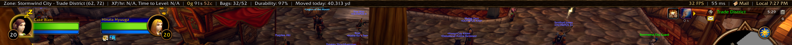

# Topline

**Your essentials, one glance away.**

Topline is a lightweight information bar for **World of Warcraft: Forever**.
It puts useful character and session information in a thin strip across the top
of your screen, with a dark leather background and bronze trim that fits the
classic WoW interface.

Inspired by the basics of information-bar addons such as Titan Panel, Topline
keeps the focus on readable information, useful hover details, and simple
right-click controls. No addon frameworks or additional dependencies required.

## What it shows

- **Location:** zone, subzone, and rounded map coordinates when available.
- **Experience:** session XP/hour and estimated time to level. Hover for session
  duration, XP earned and remaining, rested XP, and estimated kills or XP gains
  needed to level.
- **Money:** your current gold, silver, and copper. Hover for money gained,
  spent, and net change this session.
- **Bag space:** occupied and total slots in your backpack and four normal bags.
  Hover for free slots and a per-bag breakdown. Amber warns at five or fewer free
  slots; red means full.
- **Durability:** overall equipped-item durability, with per-item details and
  damaged/broken counts. Amber warns below 30%; red warns below 10%.
- **Distance traveled:** yards moved today, plus session distance, recorded
  lifetime distance, and recent daily history in the tooltip.
- **Performance:** FPS and latency, with home/world latency on hover and subtle
  warning colors when performance drops.
- **Mail:** a small indicator when the game reports new mail, with recent senders
  when available. It disappears when there is no notification.
- **Clock:** local time on the bar, with the local date and realm time on hover.

## Make it yours

**Right-click anywhere on the bar** to show or hide items, change their order,
or move them between the left and right groups. Your layout choices are saved
per character. Hidden items keep tracking in the background.

- **Show/hide items → Restore defaults** enables every item again.
- **Reorder items → Restore default order** restores original positions and groups.
- **Right-click XP or money → Reset session** restarts that item's session counters.
- **Click …** at the end of a crowded group to access clipped items, their hover
  details, and available actions.

The bar adapts to UI scale and available space, shrinking text modestly when
needed. It also moves supported default UI frames below the strip when they
would overlap it; protected-frame adjustments wait until combat ends.

There are no slash commands or separate configuration screens to learn.

## Installation and compatibility

Topline currently targets **World of Warcraft: Forever's `_classic_beta_` client**
(Interface **16001**). Compatibility with Retail, Anniversary, or other Classic
branches is not claimed.

1. Download and extract the addon into your game's
   `_classic_beta_/Interface/AddOns/` folder.
2. Confirm the resulting path is `Interface/AddOns/Topline/Topline.toc`, without
   an extra nested folder.
3. Enable **Topline** in the AddOns list. Restart the client if a new installation
   does not appear; use `/reload` after updating an existing installation.

## A few useful details

**XP estimates need a little time.** XP/hour and time to level show N/A until
at least 60 seconds have elapsed and you have earned XP. Kill/gain estimates need
an observed reward and assume similar rewards afterward. Normal level-ups keep
tracking; max-level characters get a simplified display.

**Sessions start fresh on login or UI reload.** XP and money session counters
are not saved. Money statistics reflect observed balance changes, including
transfers; they are not a categorized transaction log.

**Travel history is per character.** Days roll over at local midnight. Walking,
running, swimming, and ordinary mounted travel count; taxis and vehicles do not.
Distance is an estimate, and restricted movement data can leave gaps.

**Forever is a beta client.** If the client fails to restore SavedVariables,
layout preferences and travel history may not load. Topline includes a temporary
travel-history backup for reloads within the same game launch; this cannot restore
missing disk data after a full game restart and does not back up layout settings.

## Reporting a problem

Please include your game version/build, Topline version, what you were doing,
and the exact error message or a screenshot. For layout issues, include your UI
scale and which items are in each group.

Developer reference: [implementation and validation notes](DEVELOPMENT.md).
